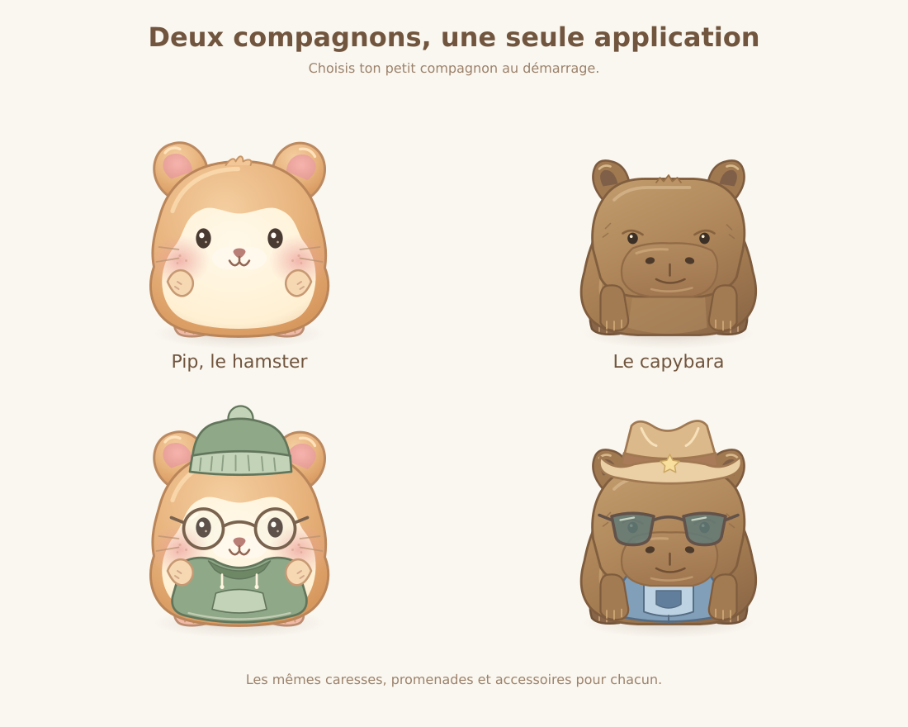

# Pip & Capy, tes compagnons de bureau

Un hamster ou un capybara qui se promène sur ton bureau Windows ou Mac,
ferme les yeux quand tu le caresses avec la souris et porte les accessoires
que tu choisis. Deux personnages originaux dans **une seule application**.



## Télécharger et lancer

**[Télécharger la dernière version](https://github.com/cleementt26/pip-hamster/releases/latest)**

| Ordinateur | Archive | Premier lancement |
| --- | --- | --- |
| Windows 10 / 11, 64 bits | `Pip-Windows-x64.zip` | Extraire tout, puis ouvrir `Pip.exe`. |
| Mac avec puce Apple M1 ou plus récente | `Pip-Mac-Apple-Silicon.zip` | Décompresser, puis ouvrir `Ouvrir Pip.command` à côté de `Pip.app`. |
| Mac Intel | `Pip-Mac-Intel.zip` | Décompresser, puis ouvrir `Ouvrir Pip.command` à côté de `Pip.app`. |

Sur Mac, macOS Ventura 13 ou plus récent est nécessaire. La puce est indiquée
dans le menu Apple > À propos de ce Mac. Conserve les composants de chaque
dossier ensemble.

Au démarrage, sélectionne **Pip, le hamster**, ou **Capy, le capybara**, puis
clique sur **Inviter sur mon bureau**. Ton dernier choix est présélectionné.
Pour changer ensuite : clic droit sur le compagnon ou sur son icône près de
l'horloge > **Choisir mon compagnon…**.

Les versions sont portables et non signées par un éditeur. Windows peut afficher
un avertissement au premier lancement. Sur Mac, le lanceur prépare uniquement
`Pip.app` : il retire la quarantaine et applique une signature locale à cette
application. Il ne demande pas de mot de passe et ne modifie pas les réglages
généraux de sécurité. Après ce premier lancement, tu peux déplacer `Pip.app`
dans Applications et l'ouvrir normalement.

Si macOS bloque le lanceur, fais clic droit > Ouvrir ; après une tentative,
une autorisation peut apparaître dans Réglages Système > Confidentialité et
sécurité. Le fichier `LISEZ-MOI.txt` de chaque archive contient les détails.

## Caresses, promenades et personnalisation

- **Caresser :** passer doucement la souris sur le compagnon. Il s'arrête,
  ferme les yeux et laisse apparaître de petits cœurs.
- **Déplacer :** maintenir le clic gauche et faire glisser le compagnon.
- **Nourrir :** double-cliquer pour lui donner une graine.
- **Personnaliser :** clic droit > **Personnaliser mon compagnon**.
- **Quitter :** choisir **Quitter Pip** dans ce menu.

La garde-robe comprend un bonnet, une casquette, une couronne, une fleur,
un chapeau de cowboy, trois paires de lunettes, un sweat à capuche,
une marinière, une écharpe et une salopette. Cinq couleurs sont disponibles :
sauge, bleu, rose, lilas et orange. Le choix **Surprends-moi** compose une tenue.
**Chaque animal garde sa tenue séparément**, même après fermeture de l'application.
Les anciennes préférences et la tenue du hamster sont conservées lors de la mise à jour.

Le menu propose aussi trois tailles, trois vitesses, la promenade partout
sur l'écran ou au bas de l'écran, une pause, une sieste et le choix d'un écran.
Le démarrage à la connexion est facultatif et désactivé par défaut.
Taille, vitesse, zone de promenade et premier plan sont mémorisés.

Les compagnons passent au-dessus des fenêtres par défaut et peuvent explorer
toute la surface de travail. Ils ne détectent pas les rebords des fenêtres.
Les parties transparentes laissent les clics atteindre les applications derrière.
Une application en plein écran exclusif peut les masquer.

## Fonctionnement et validation

L'application fonctionne hors ligne, sans compte, publicité ni suivi.
Elle ne lit ni tes documents ni le contenu de ton écran ; elle utilise la
position du pointeur pour réagir aux caresses et aux déplacements.

Les 36 tests automatiques vérifient les interactions des deux espèces, le
sélecteur, la sécurité des échanges entre fenêtres, les garde-robes séparées,
la migration des préférences, les limites et changements d'écran, ainsi que
la reprise après veille. Les API natives d'Electron sont simulées dans ces tests.
Les archives sont générées depuis Linux. **Le lancement natif sur Windows et
macOS reste à confirmer sur ces systèmes.** Cette version n'est pas signée
par un éditeur ni notariée par Apple.

## Modifier et reconstruire

Installer Node.js 22.12 ou plus récent, puis dans ce dossier :

```sh
npm ci
npm exec install-electron
npm start
```

L'installation explicite d'Electron est nécessaire avec sa version 45.

```sh
npm test
npm run package
```

Les ZIP sont créés dans `releases/`. `npm run package -- windows`,
`npm run package -- mac-arm64` et `npm run package -- mac-intel` limitent la
construction à une cible. La commande `zip` doit être disponible pour cette
construction depuis Linux/macOS. Une construction sur Windows nécessite une
adaptation de la commande d'archivage.

Le code applicatif n'a aucune dépendance de production. Les dessins SVG
originaux sont animés avec CSS et JavaScript dans une fenêtre Electron
transparente. Le sélecteur utilise une fenêtre séparée et isolée.
Les versions de développement sont fixées dans `package-lock.json`.
Licence MIT pour le code et les dessins originaux ; les licences tierces
sont conservées dans les applications distribuées.

Le dépôt garde son adresse historique `pip-hamster` ; il contient désormais
les deux compagnons.
